# Modelo de dados da PetMeet

```mermaid
erDiagram
    USUARIOS ||--o{ PROCESSOS_ADOCAO : "responsavel"
    USUARIOS ||--o{ LOGS_AUDITORIA : "autor"
    PETS ||--o{ PROCESSOS_ADOCAO : "e adotado em"
    PETS ||--o{ APADRINHAMENTOS : "e apadrinhado em"
    PETS ||--o{ ATENDIMENTOS_CLINICOS : "tem na ficha clinica"
    USUARIOS ||--o{ ATENDIMENTOS_CLINICOS : "veterinario que registrou"
    PETS ||--o{ APLICACOES_VACINA : "tem no cartao de vacinacao"
    VACINAS ||--o{ APLICACOES_VACINA : "aplicada em"
    USUARIOS ||--o{ APLICACOES_VACINA : "veterinario que aplicou"
    ADOTANTES ||--o{ PROCESSOS_ADOCAO : "solicita"
    PADRINHOS ||--o{ APADRINHAMENTOS : "apadrinha"
    PADRINHOS ||--o{ DOACOES : "contribui com"

    USUARIOS {
        int id PK
        string nome
        string email
        string senha_hash
        enum perfil "admin | voluntario | veterinario"
        bool ativo
    }
    PETS {
        int id PK
        string nome
        enum especie "cachorro | gato | outro"
        int idade
        date data_resgate
        enum status_saude "saudavel | em_tratamento_medico | em_recuperacao"
        string doenca_atual "obrigatorio se em_tratamento_medico"
        enum situacao_adocao "disponivel | em_processo_adocao | adotado"
        string foto_url
    }
    ADOTANTES {
        int id PK
        string nome
        string cpf UK
        string email
        string telefone
        string endereco
    }
    PADRINHOS {
        int id PK
        string nome
        string cpf UK
        string email
        string telefone
    }
    APADRINHAMENTOS {
        int id PK
        int padrinho_id FK
        int pet_id FK
        enum frequencia "pontual | recorrente"
        bool ativo
        date data_inicio
    }
    PROCESSOS_ADOCAO {
        int id PK
        int pet_id FK
        int adotante_id FK
        int responsavel_id FK
        enum status "em_analise | aprovado | finalizado | cancelado"
        bool acompanhamento_medico_em_dia
    }
    DOACOES {
        int id PK
        int padrinho_id FK "nulo se doador avulso"
        string doador_nome "nulo se padrinho cadastrado"
        decimal valor "CHECK > 0"
        date data
        enum tipo "pontual | recorrente"
    }
    ATENDIMENTOS_CLINICOS {
        int id PK
        int pet_id FK "RESTRICT"
        int veterinario_id FK "RESTRICT"
        date data_atendimento "nao pode estar no futuro (dia de Brasilia)"
        string anamnese
        string diagnostico
        string conduta
        datetime anulado_em "nulo se valido"
        int anulado_por_id FK
        string motivo_anulacao
    }
    VACINAS {
        int id PK
        string nome "gravado sem espacos nas pontas, em NFC"
        string nome_chave UK "NFC + casefold, calculada no app"
        enum especie "cachorro | gato | outro; nulo = todas"
        int intervalo_reforco_dias "sugestao da proxima dose; CHECK > 0"
        bool ativa "inativa sai das aplicacoes novas"
    }
    APLICACOES_VACINA {
        int id PK
        int pet_id FK "RESTRICT"
        int vacina_id FK "RESTRICT"
        int veterinario_id FK "RESTRICT"
        date data_aplicacao "nao pode estar no futuro (dia de Brasilia)"
        date proxima_dose "CHECK > data_aplicacao; pode estar no passado"
        string lote
        string observacao
        datetime anulado_em "nulo se valida"
        int anulado_por_id FK
        string motivo_anulacao
    }
    LOGS_AUDITORIA {
        int id PK
        int usuario_id FK
        string entidade
        int entidade_id
        string acao
        json dados_antigos
        json dados_novos
    }
```

## Constraints e indices relevantes (RNF07)

| Tabela | Constraint/Indice | Motivo |
|---|---|---|
| `usuarios.email` | UNIQUE + indice | login por email precisa ser rapido e sem duplicatas |
| `adotantes.cpf` / `padrinhos.cpf` | UNIQUE + indice | evita cadastro duplicado da mesma pessoa |
| `pets.situacao_adocao` / `pets.status_saude` | indice | filtros de listagem mais usados (RF05) |
| `apadrinhamentos (padrinho_id, pet_id)` | UNIQUE | mesmo padrinho nao apadrinha o mesmo pet duas vezes |
| `processos_adocao (pet_id) WHERE status='finalizado'` | UNIQUE parcial | **RN02/RF17**: um pet, no máximo, um processo finalizado |
| `doacoes.valor` | CHECK `valor > 0` | **RN05**, reforçada tambem no schema Pydantic |
| `doacoes.data` | indice | consultas por período (RF13) |
| `atendimentos_clinicos (pet_id, data_atendimento)` | indice | ficha clínica do pet, do mais recente para o mais antigo |
| `atendimentos_clinicos` | CHECK anulação completa | anulado = quando, quem e motivo juntos; atendimento não é editado nem apagado (D8) |
| `atendimentos_clinicos.pet_id` | FK `RESTRICT`, sem cascade no modelo | apagar um pet não leva o histórico clínico junto (A-09) |
| `vacinas.nome_chave` | UNIQUE | "V10", " v10 " e "ANTIRRÁBICA"/"Antirrábica" são a mesma vacina (A-10). A chave é calculada no Python (NFC + `casefold`), não com `lower()` no banco: o `lower()` só trata acentos quando a collation do banco é como `en_US.utf8` |
| `aplicacoes_vacina (pet_id, vacina_id, data_aplicacao) WHERE anulado_em IS NULL` | UNIQUE parcial | uma aplicação válida por vacina, pet e dia; a anulada não conta (H5.4) |
| `aplicacoes_vacina` | CHECK próxima dose depois da aplicação; CHECK anulação completa | regras do cartão garantidas também no banco |
| `aplicacoes_vacina.pet_id` / `.vacina_id` | FK `RESTRICT` | nem o pet nem a vacina levam o cartão junto (A-09) |

O status de cada vacina (*em dia*, *vencendo*, *vencida*, *sem reforço*) não é gravado: é calculado a cada leitura pela **última aplicação válida** de cada vacina no pet (`DISTINCT ON`), com "hoje" em `America/Sao_Paulo`.

## Por que `doenca_atual` e `acompanhamento_medico_em_dia` existem

Essas duas colunas sustentam diretamente a regra crítica RN01/RF16:

- `Pet.doenca_atual` — obrigatório sempre que `status_saude` for
  `em_tratamento_medico` (validado no schema Pydantic e reforçado no serviço).
  É o "identificar qual doença está sendo tratada" citado no RF16.
- `ProcessoAdocao.acompanhamento_medico_em_dia` — **histórico**. Na versão
  recebida, marcar o acompanhamento em dia liberava a finalização de um pet em
  tratamento. Com a decisão D1 a regra passou a ser literal — pet em tratamento
  não finaliza, sem exceção — e o campo deixou de ser lido. A coluna fica para
  não apagar o registro dos processos finalizados antes da mudança.
